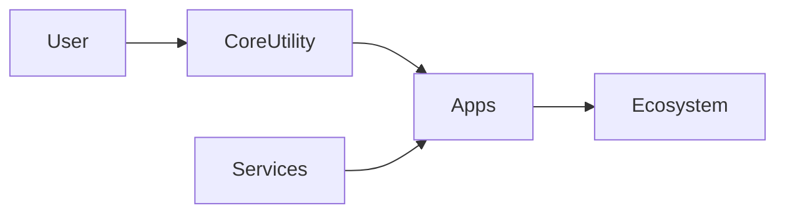

# Technical Capability Map

Use this template to connect architecture and features to economic possibilities.

## Architecture overview

Summarize the technical system in a few paragraphs.

## Capability map

| Capability | Evidence | What it enables | Economic / organizational pattern | What must be developed | Gate / risk |
| ----- | ----- | ----- | ----- | ----- | ----- |
|  |  |  |  |  |  |

## Diagram

Use Mermaid only if it clarifies the system. Keep labels short and avoid styling.

## Technical claims checklist

- [ ] Each capability is evidenced.
- [ ] Speculative extensions are marked as future-facing.
- [ ] Architecture is linked to economic possibility.
- [ ] Governance and monetization gates are visible.
- [ ] The organization is not credited with systems it has not built.

## Summary

What is technically plausible, and what is still organizationally incomplete?
